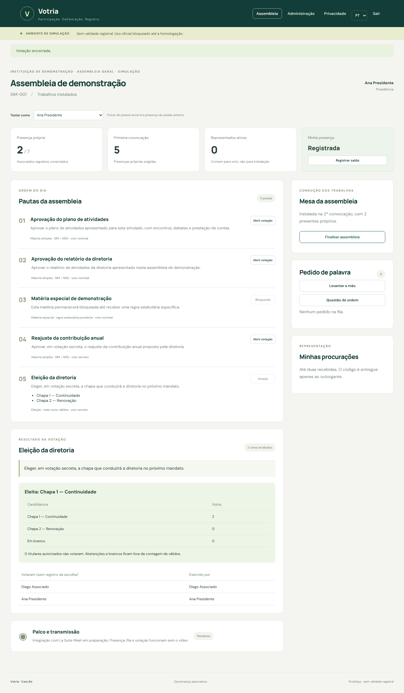
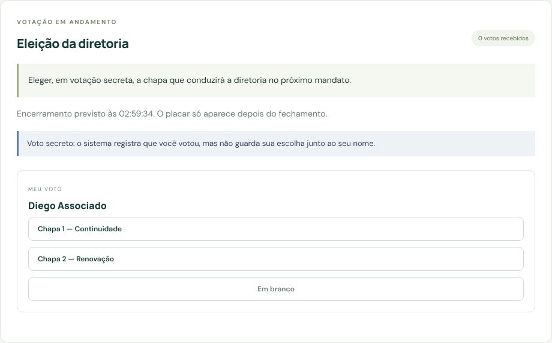
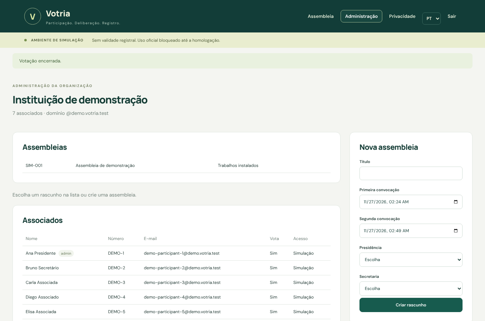
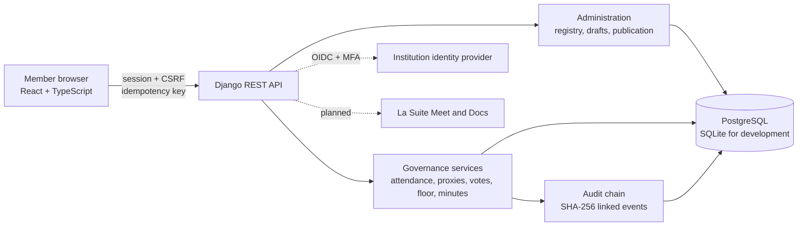

# Votria

[](https://github.com/anacamilabernardes/assembly-voting-platform-votria/actions/workflows/checks.yml)
[](https://github.com/anacamilabernardes/assembly-voting-platform-votria/actions/workflows/codeql.yml)
[](LICENSE)
[](backend/requirements.in)

Votria lets associations and other member institutions run a general assembly online: members confirm attendance, grant proxies, follow the agenda, ask for the floor and vote, and the chair closes the meeting with draft minutes and a verifiable audit trail. It is a Cam.Be product.

> **Status:** prototype. Every assembly runs as a simulation with no legal validity; official use stays blocked until the items under [Before official use](#before-official-use) are done. Do not use it for a legally binding meeting.



## What it does

- **Institutions.** Each organization has its own members, email domain and administrators. Members of one organization never see another's assemblies.
- **Member registry.** Administrators import members from CSV. Any invalid line rejects the whole file and the error names the line.
- **Assembly setup.** Administrators create an assembly, set the first and second calls, choose the chair and secretary, build the agenda and publish. Publishing freezes the electorate.
- **Attendance and quorum.** Explicit check-in with 60-second leases, first call with a two-thirds quorum, second call with any number present.
- **Proxies.** Scoped to agenda items, delivered as a one-time code to the grantor, at most two per representative, revocable, and suspended while the grantor is present.
- **Three kinds of vote.**
  - Roll-call: YES, NO or ABSTAIN, with names published after closing.
  - Secret ballot: the system records who voted, and stores the choice separately with no voter, no timestamp and no trace in receipts, audit events or idempotency records.
  - Elections: candidates or slates, always secret, plurality wins, ties elect no one, blank votes counted apart.
- **Floor requests.** A regular queue and points of order, granted by the chair.
- **Minutes.** A printable HTML page (save as PDF from the browser) and the same facts as JSON, with the audit root hash.
- **Audit.** Every command is idempotent; votes and audit events are immutable at the database level; `verify_audit` recomputes the hash chain.
- **Privacy.** A privacy notice and an `apply_retention` command that purges operational data after a configurable period.
- **Interface** in Portuguese and English, switchable without reloading.

| Secret election ballot | Administration |
|---|---|
|  |  |

## Architecture



Every write goes through one command function: it locks the assembly row, rejects repeated idempotency keys with different content, expires attendance leases, closes rounds whose time is up, runs the operation and stores the response. Votes, secret ballots, participation records and audit events have database triggers that reject updates and deletes.

## Technology stack

| Area | Technology |
|---|---|
| Backend | Python 3.12+, Django 5.2, Django REST Framework |
| Frontend | React 19, TypeScript, Vite, self-hosted fonts |
| Data | PostgreSQL for deployment; SQLite for development and tests |
| Identity | Session sign-in for simulations; OIDC with MFA level and first-login account binding |
| Quality | ruff, ESLint, Prettier, Django tests, Playwright end-to-end tests, CodeQL, Dependabot |
| Deployment | Docker, Render Blueprint, GitHub Actions |

## Run locally

Requirements: Python 3.12 or 3.13, Node.js 22 and pnpm 11.

```sh
python -m venv .venv && .venv/bin/pip install -r backend/requirements.txt
.venv/bin/python backend/manage.py migrate
.venv/bin/python backend/manage.py seed_demo
.venv/bin/python backend/manage.py runserver 127.0.0.1:8000 --noreload
# in another terminal
cd frontend && pnpm install --frozen-lockfile && pnpm dev
```

Open http://127.0.0.1:5173 and pick a fictional person. Ana Presidente chairs the demo assembly and administers the demo institution. Use separate browser profiles to act as several people at once; tabs in one profile share one identity.

With Docker, `docker compose up --build` runs PostgreSQL and the same image as production at http://127.0.0.1:8000. Set `DJANGO_SECRET_KEY`, `POSTGRES_PASSWORD` and `VOTRIA_DEMO_ACCESS_PASSWORD` (16+ characters) first.

## Configure the institution

Each deployment starts with one default institution, defined by environment variables. More organizations can be added in the database.

| Variable | Purpose | Example |
| --- | --- | --- |
| `VOTRIA_INSTITUTION_NAME` | Name shown on the sign-in screen and in the minutes | `Example Association` |
| `VOTRIA_ALLOWED_EMAIL_DOMAIN` | The only email domain its members can use; exact match, no subdomains | `example.org` |
| `VOTRIA_REQUIRED_ACR` | Authentication assurance level the identity provider must report | Given by the institution |
| `VOTRIA_RETENTION_DAYS` | Days before `apply_retention` purges operational data | `365` |

Fictional demo accounts are created as `demo-participant-N@<domain>`, or on `demo.votria.test` when no domain is set. If the domain changes, `seed_demo` (run on every Render start) moves the demo accounts and keeps all history. Demo addresses never receive email.

Institutional sign-in also needs `OIDC_ISSUER`, `OIDC_CLIENT_ID`, `OIDC_CLIENT_SECRET` and `OIDC_REDIRECT_URI`. A member imported from CSV is bound to the identity provider account on first sign-in; later sign-ins must match. Never commit secrets.

## Import members

Upload a CSV in **Administration**:

```csv
name,email,member_number,can_vote,can_speak,is_admin
Joana Lima,joana@example.org,1001,yes,yes,no
Paulo Reis,paulo@example.org,1002,no,yes,no
```

`name`, `email` and `member_number` are required; the flags accept yes/no or sim/não. Existing members are updated by number. Tick **simulation accounts** to let the imported people sign in through the test screen, without an identity provider.

## Operations

| Command | What it does |
|---|---|
| `python backend/manage.py seed_demo` | Creates the default institution and the demo assembly; never deletes data |
| `python backend/manage.py verify_audit [--assembly CODE]` | Recomputes every audit hash chain and fails if an event was altered or removed |
| `python backend/manage.py apply_retention [--days N] [--dry-run]` | Deletes expired proxy codes, failed code attempts, idempotency receipts and session identifiers; keeps votes, attendance and audit |

## Validation

```sh
python backend/manage.py test governance        # 84 backend tests
ruff check backend && ruff format --check backend
cd frontend && pnpm lint && pnpm build
pnpm e2e                                        # 7 Playwright tests against Django + the built interface
```

GitHub Actions runs the backend suite on SQLite and PostgreSQL, lint and build, the end-to-end tests in Chromium, the Docker image build and CodeQL. The end-to-end suite fails on any console error or Content-Security-Policy violation. To regenerate the screenshots above, run `SCREENSHOTS=1 pnpm e2e screenshots`.

## Known limits of secret ballots

Choices are stored without voter, timestamp or ordering data, and nothing that names the voter (receipts, audit events, idempotency records, logs) carries the choice. A database administrator with low-level access to transaction metadata could still correlate rows written in the same transaction. Closing that gap needs a cryptographic voting scheme (mixnet or homomorphic tally), listed in the backlog.

## Before official use

Connect and test a real identity provider and member registry; WebAuthn ceremonies for attendance and proxies; approved statutory rules for special matters; dual approval for board actions; ICP-Brasil signatures, PDF/A minutes, RFC 3161 timestamps, WORM storage and an offline verifier; cryptographic secret ballots; real email delivery; pause, extension and annulment flows; observability, high availability and disaster recovery; PostgreSQL concurrency, accessibility, security and 8,000-participant load testing; legal review of the privacy notice. Do not lift the official-use block until these are done and reviewed.

## Project docs

- [Implementation backlog](docs/BACKLOG.md)
- [Render deployment guide](docs/RENDER.md)
- [Validation record](docs/VALIDATION.md)
- [Privacy notice template](docs/PRIVACY.md)
- [Security policy](SECURITY.md)
- [Contributing guide](CONTRIBUTING.md)
- [Changelog](CHANGELOG.md)
- [MIT License](LICENSE)
