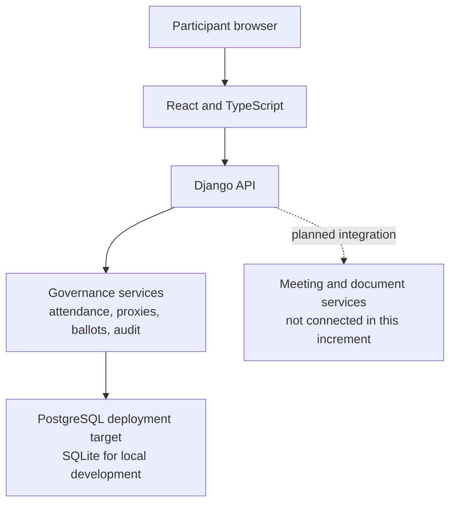

# Votria

Votria is an open-source prototype for online assembly governance and roll-call voting. It helps associations run a structured meeting with attendance, proxy authorizations, agenda-based ballots, and an auditable event history.

> **Status:** simulation prototype. Official voting is blocked. Do not use real member data or rely on this software for a legally binding meeting.

## What it includes

- Django backend and React/TypeScript interface.
- Explicit attendance sessions and first-/second-call quorum checks.
- Proxy authorizations with scope, acceptance, revocation, and a two-proxy limit.
- One ballot per eligible principal and agenda item, including votes cast by representatives.
- Results revealed after voting closes, with simple majority defined as YES > NO; abstentions are recorded and excluded from the denominator.
- Idempotent commands, immutable vote and audit records, and hash-linked audit events.
- Fictional demo accounts and a Render deployment blueprint.

## Architecture

## Technology stack

| Area | Technology |
|---|---|
| Backend | Python, Django, Django REST Framework |
| Frontend | React, TypeScript, Vite |
| Data | PostgreSQL for deployment; SQLite for local and sequential tests |
| Identity | Session authentication for the demo; OIDC integration is configurable but not yet connected to a real provider |
| Deployment | Docker, Render Blueprint, GitHub Actions |

## Demo and screenshots

No public demo URL or verified screenshots are available in this repository yet. The [Render deployment guide](docs/RENDER.md) explains how to create a password-protected demo with fictional data.

## Run locally

Requirements: Python 3.12 or 3.13, Node.js compatible with Vite 7, and pnpm 11.

1. Create a Python environment: `python -m venv .venv`.
2. Install dependencies: `.venv/Scripts/python.exe -m pip install -r backend/requirements.txt` (Windows) or `.venv/bin/python -m pip install -r backend/requirements.txt` (Linux).
3. Apply migrations and seed fictional data: `python backend/manage.py migrate` and `python backend/manage.py seed_demo`, using the environment's Python.
4. Start the backend: `python backend/manage.py runserver 127.0.0.1:8000 --noreload`.
5. In `frontend`, run `pnpm install --frozen-lockfile` and `pnpm dev`.
6. Open http://127.0.0.1:5173.

Optional: `docker compose up --build` starts the development backend and PostgreSQL. Set random values for `DJANGO_SECRET_KEY` and `POSTGRES_PASSWORD` first. The frontend must still be started separately. This compose setup is for development, not production.

To configure an institutional identity provider, set `VOTRIA_ALLOWED_EMAIL_DOMAIN`, `VOTRIA_REQUIRED_ACR`, and the OIDC settings in `.env`. The demo login uses the `VOTRIA_DEMO_MODE` and `VOTRIA_DEMO_ACCESS_PASSWORD` environment variables. Never commit secrets.

## Validation

Run the backend suite with `python backend/manage.py test governance --verbosity 2` and build the frontend with `pnpm build`. GitHub Actions also runs the configured checks on pushes and pull requests. PostgreSQL concurrency and production-scale behavior require separate validation; the local SQLite setup is for sequential development and tests.

## Project docs

- [Implementation backlog](docs/BACKLOG.md)
- [Render deployment guide](docs/RENDER.md)
- [Validation record](docs/VALIDATION.md)
- [Security policy](SECURITY.md)
- [Contributing guide](CONTRIBUTING.md)
- [Changelog](CHANGELOG.md)
- [MIT License](LICENSE)

La Suite meeting and document integrations are not connected in this increment. The project does not issue media tokens or use public room URLs as evidence of attendance.
